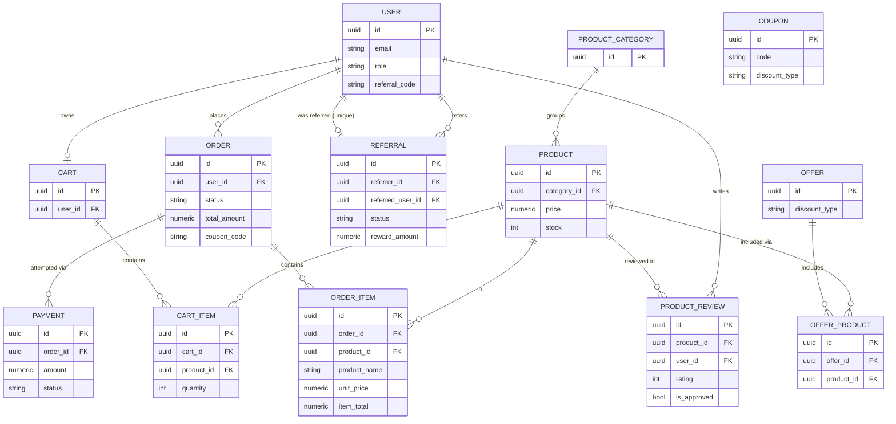

# Green Village
## Technical Documentation — Agriculture E-Commerce Platform

**Project:** Green Village
**Type:** Agriculture E-Commerce Web Application
**Backend:** Python, Django, Django REST Framework, PostgreSQL
**Frontend:** Separate application, REST API consumer (UI/UX already completed)
**Audience:** College / academic project implementation
**Document version:** 1.0

---

## 1. Project Overview

### 1.1 Project Name
Green Village

### 1.2 Project Purpose
Green Village is a simple, focused agriculture e-commerce platform where customers can browse and buy agriculture-related products (seeds, plants, fertilizers, tools, etc.) directly from a single seller — the platform itself, operated by the admin. There is no third-party seller/vendor marketplace.

### 1.3 Problem Statement
Small agriculture retailers and individual buyers often lack a simple, dedicated online store for agriculture products. General-purpose e-commerce platforms are not tailored to this category, and full marketplace platforms are heavier than a single-seller store needs. Green Village addresses this gap with a lightweight, single-seller e-commerce system built specifically for agriculture products.

### 1.4 Main Objectives
- Provide a working, deployable e-commerce backend within a 3-week core development window.
- Support the full customer purchase journey: browse → cart → checkout → pay → track order.
- Give the admin full control over catalog, orders, payments, reviews, coupons, offers, and referrals.
- Keep the architecture simple enough to be fully understood, tested, and defended as a college project, while following production-grade practices (normalized schema, server-side price calculation, transactional checkout, JWT auth).

### 1.5 Target Users
- **Customers** — individuals who want to buy agriculture products online.
- **Admin** — the platform operator who manages catalog, orders, payments, promotions, and customers.

### 1.6 User Roles
| Role | Description |
|---|---|
| `customer` | Registers, browses, buys, pays, reviews, uses coupons/offers/referrals |
| `admin` | Manages all catalog, order, payment, review, coupon, offer, and referral data |

There is **no seller/vendor role**. All products are owned and managed by the admin.

### 1.7 Technology Stack
| Layer | Technology |
|---|---|
| Backend language | Python 3 |
| Backend framework | Django |
| API layer | Django REST Framework (DRF) |
| Database | PostgreSQL |
| Authentication | JWT (access + refresh tokens) |
| Frontend | Separate application (already designed), consumes REST APIs only |

### 1.8 High-Level Architecture

```text
┌─────────────┐        HTTPS / REST (JSON)        ┌───────────────────────┐
│  Frontend    │ ───────────────────────────────▶ │  Django + DRF Backend  │
│ (separate)   │ ◀─────────────────────────────── │  (config + 7 apps)     │
└─────────────┘                                    └───────────┬───────────┘
                                                                 │
                                                                 ▼
                                                       ┌───────────────────┐
                                                       │   PostgreSQL DB    │
                                                       └───────────────────┘
```

The backend is a single Django project exposing a versioned REST API (`/api/`). The frontend never talks to the database directly — every read/write goes through the API, so all business rules (stock checks, price calculation, coupon validation) are enforced in one place.

### 1.9 Customer Workflow
```text
Register/Login → Browse categories/products → Add to cart → Apply coupon (optional)
   → Checkout → Pay → Order confirmed → Track order status → Review purchased product
```

### 1.10 Admin Workflow
```text
Login → Manage categories/products → Monitor incoming orders → Update order status
   → Monitor payments → Moderate reviews → Manage coupons/offers → Manage referrals
   → View dashboard metrics
```

### 1.11 Project Scope (Current / In-Scope)
- Customer registration, login, JWT authentication, profile management
- Product catalog: categories and products (admin-managed)
- Shopping cart (one active cart per customer)
- Checkout and order management
- Payments (generic, gateway-agnostic) with status tracking
- Product reviews (one per customer per product, purchase-verified)
- Coupons (percentage/fixed discounts)
- Offers (product-linked promotional discounts)
- Referrals (referral code, reward on completion)
- Admin management across all of the above

### 1.12 Out-of-Scope Features (Explicitly Excluded from Current Scope)
- Seller/vendor accounts, seller onboarding, seller payouts
- Agriculture services or service booking
- Articles, blog, news, or content management
- Courses or any learning/enrollment system
- Marketplace-style multi-seller functionality

These are not planned even for a later phase unless the project's scope is formally revised — see §19 Future Enhancements for what *is* reasonable to add later.

---

## 2. Technology Stack (Summary)

| Component | Choice | Reason |
|---|---|---|
| Language | Python 3.11+ | Django/DRF ecosystem, team familiarity |
| Framework | Django | Batteries-included, ORM, admin site, migrations |
| API | Django REST Framework | Serializers, permissions, viewsets, browsable API |
| Database | PostgreSQL | Strong constraint/transaction support, production-ready |
| Auth | JWT (e.g. `djangorestframework-simplejwt`) | Stateless auth suited to a separate frontend |
| Environment config | `.env` + `django-environ` (or similar) | Keeps secrets out of source control |

---

## 3. Architecture

### 3.1 Architectural Style
A single Django project split into focused **apps**, each owning one bounded area of the domain. Communication with the frontend is exclusively through a versioned REST API. No server-rendered templates are used for the customer/admin frontend (Django's own admin site may still be used internally for quick data checks, separate from the documented API).

### 3.2 Design Principles
- **Server is the source of truth for money.** Prices, totals, and discounts are always calculated server-side; client-submitted prices are never trusted (see §12, §15).
- **One app, one responsibility.** Each Django app owns its own models, serializers, views, and tests.
- **Historical accuracy over normalization purity.** A small number of intentional snapshot fields (documented in §6) preserve what actually happened at order time, even after catalog data changes later.
- **Simplicity first.** No feature is added because "it might be needed" — see §12 Business Rules and §19 Future Enhancements for the current/future split.

---

## 4. Django Application / Module Structure

### 4.1 Recommended Project Layout

```text
green-village/
│
├── backend/
│   ├── config/                 # project settings, root urls, wsgi/asgi
│   ├── accounts/                # users, auth, JWT, profile
│   ├── catalog/                 # categories, products
│   ├── cart/                    # cart, cart items
│   ├── orders/                  # orders, order items, checkout
│   ├── payments/                 # payment records, verification
│   ├── marketing/                # coupons, offers, offer_products, referrals
│   ├── reviews/                  # product reviews
│   ├── manage.py
│   └── requirements.txt
│
├── frontend/                     # separate application (not covered here)
├── database/                     # SQL scripts, ER diagram exports, seed data
├── docs/                         # this documentation and related docs
├── .gitignore
└── README.md
```

### 4.2 App Responsibilities

| App | Responsibility | Models | Main APIs |
|---|---|---|---|
| `accounts` | User accounts, registration, JWT auth, profile | `User` | `/api/auth/*` |
| `catalog` | Product taxonomy and catalog | `ProductCategory`, `Product` | `/api/categories/*`, `/api/products/*` |
| `cart` | Per-customer shopping cart | `Cart`, `CartItem` | `/api/cart/*` |
| `orders` | Checkout and order lifecycle | `Order`, `OrderItem` | `/api/orders/*`, `/api/admin/orders/*` |
| `payments` | Payment records and verification | `Payment` | `/api/payments/*`, `/api/admin/payments/*` |
| `marketing` | Coupons, offers, offer-product links, referrals | `Coupon`, `Offer`, `OfferProduct`, `Referral` | `/api/coupons/*`, `/api/offers/*`, `/api/referrals/*` |
| `reviews` | Product reviews and moderation | `ProductReview` | `/api/products/{id}/reviews/*`, `/api/admin/reviews/*` |

`marketing` groups coupons/offers/referrals together because they share the same nature (promotional, admin-authored, customer-applied) and are small enough individually not to justify three separate apps — splitting them further would add app-boilerplate without a real benefit at this scale.

### 4.3 Where Things Live (per app)

```text
<app>/
├── models.py           # ORM models only — no business logic beyond simple model methods/properties
├── serializers.py       # request/response shaping + field-level validation
├── views.py             # DRF views/viewsets — thin; delegate real logic to services.py
├── services.py           # business logic: checkout transaction, coupon validation, payment verification, referral completion
├── permissions.py        # custom DRF permission classes (e.g. IsAdmin, IsOwner)
├── urls.py               # app-level URL routing, included from config/urls.py
├── admin.py               # Django admin registration (internal use)
└── tests/                 # unit + API tests for this app
    ├── test_models.py
    ├── test_serializers.py
    └── test_views.py
```

**Business logic placement rule:** views stay thin (parse request → call a service function → serialize response). Anything that touches more than one model, runs inside a transaction, or encodes a business rule (checkout, coupon validation, payment verification, referral completion) lives in that app's `services.py`, not in the view or the serializer. This keeps logic unit-testable independent of HTTP, and keeps serializers focused on shape/validation rather than side effects.

---

## 5. Database Models

**PK strategy:** every table uses a UUID primary key (`UUIDField(primary_key=True, default=uuid4, editable=False)`). Rationale: every table here is reachable through a customer- or admin-facing API endpoint, so a single consistent ID strategy avoids mixing UUID and integer PKs across FKs, and prevents customers from being able to guess/enumerate other customers' order or payment IDs by incrementing a number in the URL.

**Money/quantity types:** `DecimalField(max_digits=10, decimal_places=2)` for all money fields (never `FloatField` — avoids binary floating-point rounding errors in currency math); `PositiveIntegerField` for quantities and counters; `BooleanField` for all active/status flags; `DateTimeField` (Django stores as `TIMESTAMPTZ` when `USE_TZ=True`, which is the PostgreSQL-appropriate choice for timestamps).

### 5.1 users
**Django model name:** `User` (custom user model, `AbstractBaseUser` + `PermissionsMixin`, `AUTH_USER_MODEL = "accounts.User"`)
**Purpose:** single account table for both customers and admins.

| Field | Django type | Required | Default | Notes |
|---|---|---|---|---|
| id | UUIDField (PK) | — | `uuid4` | |
| email | EmailField | Yes | — | `unique=True` — login identity |
| password | (handled by `AbstractBaseUser`) | Yes | — | stored hashed, never plaintext |
| full_name | CharField(150) | Yes | — | |
| phone | CharField(20) | No | `""` | |
| role | CharField(20, choices) | Yes | `"customer"` | `customer` / `admin` |
| referral_code | CharField(20) | Yes | auto-generated on create | `unique=True` — this user's own shareable code |
| is_active | BooleanField | Yes | `True` | account status |
| date_joined | DateTimeField | Yes | `now` | |
| updated_at | DateTimeField | Yes | `now` (auto_now) | |

**PK:** `id`. **FKs:** none (root entity). **Unique constraints:** `email`, `referral_code`. **Check constraints:** `role IN ('customer','admin')`. **Indexes:** `email` (from unique), `role` (admin/customer filtering).
**Business rules:** email is the login identity and must be unique; `role` is fixed at two values, no roles table; `referral_code` is generated once at account creation and never reused.

### 5.2 product_categories
**Django model name:** `ProductCategory`
**Purpose:** product taxonomy.

| Field | Django type | Required | Default | Notes |
|---|---|---|---|---|
| id | UUIDField (PK) | — | `uuid4` | |
| name | CharField(100) | Yes | — | `unique=True` |
| slug | SlugField(120) | Yes | — | `unique=True` |
| description | TextField | No | `""` | |
| is_active | BooleanField | Yes | `True` | |
| created_at / updated_at | DateTimeField | Yes | `now` | |

**Relationships:** one category → many products. **Indexes:** `name`, `slug` (from unique constraints).

### 5.3 products
**Django model name:** `Product`
**Purpose:** sellable catalog item. No seller field — every product belongs to the platform.

| Field | Django type | Required | Default | Notes |
|---|---|---|---|---|
| id | UUIDField (PK) | — | `uuid4` | |
| category | ForeignKey → ProductCategory | Yes | — | `on_delete=PROTECT` |
| name | CharField(150) | Yes | — | |
| slug | SlugField(180) | Yes | — | `unique=True` |
| description | TextField | No | `""` | |
| price | DecimalField(10,2) | Yes | — | CHECK ≥ 0 |
| stock | PositiveIntegerField | Yes | `0` | CHECK ≥ 0 |
| image | ImageField / URLField | No | — | |
| is_active | BooleanField | Yes | `True` | |
| created_at / updated_at | DateTimeField | Yes | `now` | |

**FKs:** `category_id → product_categories.id` (`PROTECT` — a category with products can't be deleted; deactivate instead). **Indexes:** `category_id`, `slug` (unique), partial index on `is_active=True` for storefront browsing.
**Business rules:** price and stock can never go negative; `is_active=False` hides a product from customer-facing listings without deleting order history that references it.

### 5.4 carts
**Django model name:** `Cart`
**Purpose:** one active cart per customer.

| Field | Django type | Required | Default | Notes |
|---|---|---|---|---|
| id | UUIDField (PK) | — | `uuid4` | |
| user | OneToOneField → User | Yes | — | `on_delete=CASCADE`, `unique=True` |
| created_at / updated_at | DateTimeField | Yes | `now` | |

**Business rule:** enforced as one-to-one at the DB level, not just in application code — a user can have only one cart, full stop.

### 5.5 cart_items
**Django model name:** `CartItem`
**Purpose:** line items inside a cart.

| Field | Django type | Required | Default | Notes |
|---|---|---|---|---|
| id | UUIDField (PK) | — | `uuid4` | |
| cart | ForeignKey → Cart | Yes | — | `on_delete=CASCADE` |
| product | ForeignKey → Product | Yes | — | `on_delete=CASCADE` |
| quantity | PositiveIntegerField | Yes | `1` | CHECK > 0 |
| added_at | DateTimeField | Yes | `now` | |

**Unique constraint:** `(cart, product)` — adding an already-present product increases `quantity` instead of creating a second row. **Indexes:** `product_id`.

### 5.6 orders
**Django model name:** `Order`
**Purpose:** order header — one row per checkout.

| Field | Django type | Required | Default | Notes |
|---|---|---|---|---|
| id | UUIDField (PK) | — | `uuid4` | |
| user | ForeignKey → User | Yes | — | `on_delete=PROTECT` |
| status | CharField(20, choices) | Yes | `"pending"` | pending/confirmed/processing/shipped/delivered/cancelled |
| subtotal | DecimalField(10,2) | Yes | — | sum of item totals before discount |
| discount_amount | DecimalField(10,2) | Yes | `0` | from coupon and/or offer |
| total_amount | DecimalField(10,2) | Yes | — | subtotal − discount_amount |
| coupon_code | CharField(30) | No | — | snapshot of the code used, if any |
| shipping_name | CharField(150) | Yes | — | snapshot |
| shipping_phone | CharField(20) | Yes | — | snapshot |
| shipping_address | TextField | Yes | — | snapshot |
| shipping_city | CharField(100) | Yes | — | snapshot |
| shipping_pincode | CharField(10) | Yes | — | snapshot |
| placed_at / updated_at | DateTimeField | Yes | `now` | |

**FKs:** `user_id → users.id` (`PROTECT`). **Check constraints:** `total_amount = subtotal - discount_amount` is enforced in the checkout service, not a DB CHECK (it depends on values computed together in one transaction — see §13). `total_amount ≥ 0`, `subtotal ≥ 0`. **Indexes:** `user_id`, `status`.
**Business rule:** `coupon_code` is stored as text, not a live FK-followed lookup, for the same historical reason as `order_items` snapshots — a coupon edited or deleted later must not change what a past order shows it used.

### 5.7 order_items
**Django model name:** `OrderItem`
**Purpose:** order line items — the historical record of what was actually purchased.

| Field | Django type | Required | Default | Notes |
|---|---|---|---|---|
| id | UUIDField (PK) | — | `uuid4` | |
| order | ForeignKey → Order | Yes | — | `on_delete=CASCADE` |
| product | ForeignKey → Product | Yes | — | `on_delete=PROTECT` (kept for traceability) |
| product_name | CharField(150) | Yes | — | **snapshot** |
| unit_price | DecimalField(10,2) | Yes | — | **snapshot** |
| quantity | PositiveIntegerField | Yes | — | CHECK > 0 |
| item_total | DecimalField(10,2) | Yes | — | `unit_price × quantity`, computed in the checkout service |

**Historical snapshot rationale:** `product_name` and `unit_price` are intentionally duplicated from `products`. If the admin later changes a product's name or price, every past order must still show what the customer actually paid — following the live product row would silently rewrite history. This is the one deliberate departure from strict normalization in the schema, and it's necessary rather than accidental. **Indexes:** `order_id`, `product_id`.

### 5.8 payments
**Django model name:** `Payment`
**Purpose:** one row per payment attempt against an order (supports retries — see §13).

| Field | Django type | Required | Default | Notes |
|---|---|---|---|---|
| id | UUIDField (PK) | — | `uuid4` | |
| order | ForeignKey → Order | Yes | — | `on_delete=PROTECT` — **not** one-to-one, an order can have several attempts |
| amount | DecimalField(10,2) | Yes | — | must equal `order.total_amount` at verification time |
| status | CharField(20, choices) | Yes | `"pending"` | pending/success/failed/refunded |
| method | CharField(30) | No | — | generic (e.g. `card`, `upi`) — no gateway assumed |
| provider_reference | CharField(100) | No | — | gateway transaction ID, once a gateway is chosen |
| created_at / updated_at | DateTimeField | Yes | `now` | |

**Indexes:** `order_id`, `status`.
**Business rule:** an order is only ever treated as paid once a `Payment` row for it reaches `status='success'` **and** its `amount` matches the order's server-calculated `total_amount` — a mismatched amount is rejected regardless of what the client claims (see §12, §15).

### 5.9 product_reviews
**Django model name:** `ProductReview`
**Purpose:** one rating/comment per customer per product, restricted to verified purchasers.

| Field | Django type | Required | Default | Notes |
|---|---|---|---|---|
| id | UUIDField (PK) | — | `uuid4` | |
| product | ForeignKey → Product | Yes | — | `on_delete=CASCADE` |
| user | ForeignKey → User | Yes | — | `on_delete=CASCADE` |
| rating | PositiveSmallIntegerField | Yes | — | CHECK 1–5 |
| comment | TextField | No | `""` | |
| is_approved | BooleanField | Yes | `False` | admin must approve before public display |
| created_at / updated_at | DateTimeField | Yes | `now` | |

**Unique constraint:** `(product, user)` — one review per customer per product. **Indexes:** `product_id`, `(product_id, is_approved)` for the public reviews list.
**Purchase verification:** before accepting a review, the service layer checks that an `OrderItem` exists for this `product` + `user` where the parent `Order.status = 'delivered'`. This is stricter than just "paid" — it means the customer actually received the product, which is the more defensible bar against fake reviews for a live storefront.

### 5.10 coupons
**Django model name:** `Coupon`
**Purpose:** admin-defined discount codes, customer-applied at checkout.

| Field | Django type | Required | Default | Notes |
|---|---|---|---|---|
| id | UUIDField (PK) | — | `uuid4` | |
| code | CharField(30) | Yes | — | `unique=True` |
| discount_type | CharField(20, choices) | Yes | — | `percentage` / `fixed` |
| discount_value | DecimalField(10,2) | Yes | — | CHECK > 0 |
| min_order_value | DecimalField(10,2) | Yes | `0` | |
| max_discount_amount | DecimalField(10,2) | No | — | caps a percentage discount; null = uncapped |
| usage_limit | PositiveIntegerField | No | — | null = unlimited |
| used_count | PositiveIntegerField | Yes | `0` | incremented transactionally |
| valid_from / valid_until | DateTimeField | Yes | — | |
| is_active | BooleanField | Yes | `True` | |
| created_at / updated_at | DateTimeField | Yes | `now` | |

**Indexes:** `code` (unique), `is_active`.
**Business rule:** `used_count` is incremented with a row lock (`SELECT ... FOR UPDATE`) or an atomic `F()` update inside the checkout transaction, and re-checked against `usage_limit` before commit — this closes the race condition where two simultaneous checkouts could both read "1 use left" and both succeed.

### 5.11 offers
**Django model name:** `Offer`
**Purpose:** admin-defined promotional discounts tied to specific products (not a customer-entered code).

| Field | Django type | Required | Default | Notes |
|---|---|---|---|---|
| id | UUIDField (PK) | — | `uuid4` | |
| name | CharField(150) | Yes | — | |
| description | TextField | No | `""` | |
| discount_type | CharField(20, choices) | Yes | — | `percentage` / `fixed` |
| discount_value | DecimalField(10,2) | Yes | — | CHECK > 0 |
| start_date / end_date | DateTimeField | Yes | — | |
| is_active | BooleanField | Yes | `True` | |
| created_at / updated_at | DateTimeField | Yes | `now` | |

### 5.12 offer_products
**Django model name:** `OfferProduct`
**Purpose:** many-to-many join between offers and products.

| Field | Django type | Required | Default | Notes |
|---|---|---|---|---|
| id | UUIDField (PK) | — | `uuid4` | |
| offer | ForeignKey → Offer | Yes | — | `on_delete=CASCADE` |
| product | ForeignKey → Product | Yes | — | `on_delete=CASCADE` |

**Unique constraint:** `(offer, product)` — a product isn't attached to the same offer twice. A dedicated join table (rather than `ManyToManyField` alone) is used because it's directly exposed through its own admin endpoint (`POST /api/admin/offers/{id}/products/`), which is cleaner against an explicit model than Django's implicit M2M table.

### 5.13 referrals
**Django model name:** `Referral`
**Purpose:** records one referral event — a new customer applying an existing customer's code.

| Field | Django type | Required | Default | Notes |
|---|---|---|---|---|
| id | UUIDField (PK) | — | `uuid4` | |
| referrer | ForeignKey → User | Yes | — | `on_delete=CASCADE`, `related_name="referrals_made"` |
| referred_user | ForeignKey → User | Yes | — | `on_delete=CASCADE`, `related_name="referral_used"`, `unique=True` (a user can be referred only once) |
| status | CharField(20, choices) | Yes | `"pending"` | pending/completed/cancelled |
| reward_amount | DecimalField(10,2) | No | — | set when the reward is granted |
| created_at | DateTimeField | Yes | `now` | |
| completed_at | DateTimeField | No | — | |

**Check constraint:** `referrer_id <> referred_user_id` — a user cannot refer themselves. **Indexes:** `referrer_id`.
**Business rule:** a referral is created with `status='pending'` when the referred user applies a code (typically at registration). It moves to `completed` — and `reward_amount`/`completed_at` are set — when the referred user's **first order** reaches a paid status; the reward is credited to the referrer at that point, not at signup, to avoid rewarding referrals that never convert to a real purchase.

### Table B — Database Models Summary

| Model | Purpose | Primary Key | Important Foreign Keys |
|---|---|---|---|
| User | Account (customer or admin) | id (UUID) | — |
| ProductCategory | Product taxonomy | id (UUID) | — |
| Product | Catalog item | id (UUID) | category → ProductCategory |
| Cart | One active cart per user | id (UUID) | user → User (1:1) |
| CartItem | Cart line item | id (UUID) | cart → Cart, product → Product |
| Order | Order header | id (UUID) | user → User |
| OrderItem | Order line item (historical snapshot) | id (UUID) | order → Order, product → Product |
| Payment | Payment attempt on an order | id (UUID) | order → Order |
| ProductReview | Rating/comment on a product | id (UUID) | product → Product, user → User |
| Coupon | Discount code | id (UUID) | — |
| Offer | Product-linked promotion | id (UUID) | — |
| OfferProduct | Offer ↔ Product join | id (UUID) | offer → Offer, product → Product |
| Referral | Referral event | id (UUID) | referrer → User, referred_user → User |

---

## 6. Database Relationships

```text
User          1 ── 1   Cart
User          1 ── N   Order
User          1 ── N   ProductReview
User          1 ── N   Referral        (as referrer, related_name=referrals_made)
User          1 ── 1   Referral        (as referred_user, related_name=referral_used)

ProductCategory  1 ── N  Product

Product       1 ── N   CartItem
Product       1 ── N   OrderItem
Product       1 ── N   ProductReview
Product       N ── M   Offer            (through OfferProduct)

Cart          1 ── N   CartItem
Order         1 ── N   OrderItem
Order         1 ── N   Payment

Offer         1 ── N   OfferProduct
```

Plain-language form:
- User 1 → 1 Cart (every user has exactly one cart, created at registration or first cart access)
- User 1 → Many Orders
- User 1 → Many Reviews (at most one per product, enforced by unique constraint)
- User 1 → Many Referrals as referrer; User 1 → at most 1 Referral as the referred party
- ProductCategory 1 → Many Products
- Product 1 → Many CartItems / OrderItems / Reviews
- Order 1 → Many OrderItems
- Order 1 → Many Payments (multiple attempts allowed, only one should reach `success`)
- Offer Many ↔ Many Products, through OfferProduct
- Coupon is referenced from Order only as a text snapshot (`coupon_code`), not a live FK — see §5.6

---

## 7. ER Diagram



*(`Coupon` is intentionally not drawn with a live FK to `Order` — see §5.6 for why it's a text snapshot instead.)*

---

## 8. REST API Documentation

### 8.1 Conventions
- Base prefix: `/api/`
- **Versioning:** not introduced in V1 — a single unversioned `/api/` is simplest for a 3-week college project with one frontend consumer. If the API ever needs to support multiple frontend versions at once, add `/api/v1/` as a prefix (Django URL include is a one-line change) and keep the current paths as `v1` — no other restructuring needed. Introducing versioning now, with only one consumer, would be complexity with no current payoff.
- **Auth header:** `Authorization: Bearer <access_token>` on every authenticated request.
- **Pagination:** list endpoints accept `?page=` and `?page_size=` and return `{"count", "next", "previous", "results"}` (DRF's standard `PageNumberPagination`).
- **Role column:** `Public` (no token needed), `Customer` (any authenticated user), `Admin` (authenticated + `role='admin'`).
- Response envelope and error shape are defined once in §10 (Error Handling) and apply to every endpoint below — not repeated per endpoint.

### 8.2 HTTP Status Codes Used

| Code | Meaning here |
|---|---|
| 200 | Successful GET/PATCH |
| 201 | Resource created (POST) |
| 204 | Successful DELETE, no body |
| 400 | Malformed request / general validation failure |
| 401 | Missing or invalid/expired token |
| 403 | Authenticated but not permitted (e.g. customer hitting an admin endpoint) |
| 404 | Resource does not exist (or isn't visible to this user) |
| 409 | Conflict (e.g. duplicate review, coupon already at usage limit, referral already used) |
| 422 | Semantically invalid (e.g. quantity exceeds stock, coupon expired) |
| 500 | Unhandled server error |

---

### 8.3 Authentication API

**Endpoint:** Register
**HTTP Method:** POST
**URL:** `/api/auth/register/`
**Authentication:** None
**Role:** Public
**Purpose:** Create a new customer account. Admin accounts are not self-registerable — created only via Django admin / management command.
**Request Body:** `{"email", "password", "full_name", "phone"?, "referral_code"?}`
**Example Request:**
```json
{"email": "anita@example.com", "password": "Str0ngPass!23", "full_name": "Anita Kumar", "referral_code": "RAVI2026"}
```
**Response Status:** 201 Created / 400 Bad Request
**Example Success Response:**
```json
{"success": true, "data": {"id": "b1e...9c", "email": "anita@example.com", "referral_code": "ANITA7F2K"}}
```
**Example Error Response:**
```json
{"success": false, "message": "Registration failed.", "errors": {"email": ["A user with this email already exists."]}}
```
**Validation Rules:** email unique + valid format; password meets Django's configured password validators; `referral_code`, if supplied, must belong to an existing user other than self.
**Business Rules:** new account defaults to `role='customer'`; a unique `referral_code` is generated for the new user; if `referral_code` was supplied and valid, a `Referral` row is created with `status='pending'` (see §12, §13).
**Database Tables Used:** `users`, `referrals`

**Endpoint:** Login
**HTTP Method:** POST
**URL:** `/api/auth/login/`
**Authentication:** None
**Role:** Public
**Purpose:** Authenticate and receive JWT access + refresh tokens.
**Request Body:** `{"email", "password"}`
**Response Status:** 200 OK / 401 Unauthorized
**Example Success Response:**
```json
{"success": true, "data": {"access": "eyJ...", "refresh": "eyJ...", "role": "customer"}}
```
**Example Error Response:**
```json
{"success": false, "message": "Invalid email or password.", "errors": {}}
```
**Validation Rules:** credentials must match an active (`is_active=True`) account.
**Business Rules:** access token short-lived (e.g. 15 min); refresh token longer-lived (e.g. 7 days); failed attempts return a generic message (never reveal whether the email exists).
**Database Tables Used:** `users`

**Endpoint:** Refresh Token
**HTTP Method:** POST
**URL:** `/api/auth/refresh/`
**Authentication:** None (refresh token itself is the credential)
**Role:** Public
**Purpose:** Exchange a valid refresh token for a new access token.
**Request Body:** `{"refresh"}`
**Response Status:** 200 OK / 401 Unauthorized
**Business Rules:** rejected if the refresh token is expired, blacklisted (on logout), or malformed.
**Database Tables Used:** `users` (to reconfirm the account is still active)

**Endpoint:** Logout
**HTTP Method:** POST · **URL:** `/api/auth/logout/` · **Auth:** Customer/Admin · **Purpose:** Blacklist the current refresh token so it can no longer be exchanged. **Request Body:** `{"refresh"}`. **Response:** 205/200.

**Endpoint:** Forgot Password
**HTTP Method:** POST · **URL:** `/api/auth/forgot-password/` · **Auth:** None · **Purpose:** Send a password-reset link/token to the account email. **Request Body:** `{"email"}`. **Response:** 200 (always, to avoid confirming which emails are registered).

**Endpoint:** Reset Password
**HTTP Method:** POST · **URL:** `/api/auth/reset-password/` · **Auth:** None (reset token is the credential) · **Purpose:** Set a new password using the token from the reset email. **Request Body:** `{"token", "new_password"}`. **Response:** 200 / 400 (expired/invalid token).

**Endpoint:** Get / Update Profile
**HTTP Method:** GET, PATCH · **URL:** `/api/auth/profile/` · **Auth:** Customer/Admin (own profile only) · **Purpose:** View or update the logged-in user's own profile. **PATCH Body:** `{"full_name"?, "phone"?}` — email and role are never editable through this endpoint. **Response:** 200 / 400.

---

### 8.4 Category API

| Method | URL | Role | Purpose |
|---|---|---|---|
| GET | `/api/categories/` | Public | List active categories |
| GET | `/api/categories/{id}/` | Public | Category detail |
| POST | `/api/admin/categories/` | Admin | Create category |
| PATCH | `/api/admin/categories/{id}/` | Admin | Update category |
| DELETE | `/api/admin/categories/{id}/` | Admin | Delete category (blocked if it still has products — deactivate the category instead) |

**Validation:** `name`/`slug` unique. **Business rule:** public list only returns `is_active=True` categories. **Tables used:** `product_categories`.

---

### 8.5 Product API

**Endpoint:** List Products
**HTTP Method:** GET
**URL:** `/api/products/`
**Authentication:** None
**Role:** Public
**Purpose:** Browse the catalog with search, filtering, sorting, and pagination.
**Request Parameters:** `?search=` (matches name/description), `?category=` (category id or slug), `?ordering=` (`price`, `-price`, `created_at`, `-created_at`), `?page=`, `?page_size=`
**Response Status:** 200
**Example Success Response:**
```json
{"count": 42, "next": "...?page=2", "previous": null, "results": [
  {"id": "c9a...", "name": "Tomato Seeds", "price": "89.00", "stock": 199, "is_active": true}
]}
```
**Business Rules:** only `is_active=True` products are returned to non-admin requests; `stock` is included so the frontend can grey out an out-of-stock product, but stock is still re-validated server-side at cart/checkout regardless of what the frontend shows.
**Database Tables Used:** `products`, `product_categories`

Remaining Product endpoints:

| Method | URL | Role | Purpose |
|---|---|---|---|
| GET | `/api/products/{id}/` | Public | Product detail |
| POST | `/api/admin/products/` | Admin | Create product |
| PATCH | `/api/admin/products/{id}/` | Admin | Update product (including price/stock) |
| DELETE | `/api/admin/products/{id}/` | Admin | Delete (blocked if referenced by any `order_items` — deactivate instead) |

**Tables used:** `products`, `product_categories`.

---

### 8.6 Cart API

| Method | URL | Role | Purpose |
|---|---|---|---|
| GET | `/api/cart/` | Customer | View own cart with items and running subtotal |
| POST | `/api/cart/items/` | Customer | Add a product (or increase quantity if already present) |
| PATCH | `/api/cart/items/{id}/` | Customer | Change quantity of one cart item |
| DELETE | `/api/cart/items/{id}/` | Customer | Remove one cart item |
| DELETE | `/api/cart/clear/` | Customer | Empty the cart |

**Quantity/stock validation:** `quantity` must be a positive integer (`> 0`); on add/update, the requested quantity is checked against the product's **current** `stock` — the cart never reserves stock ahead of checkout, so this is a soft check (informational, prevents obviously-impossible carts) and the authoritative check happens again at checkout under a row lock (§13), since stock can change between adding to cart and paying.
**Business Rules:** a cart is auto-created for a user on first cart access if one doesn't exist yet (one-to-one, so this is idempotent). **Tables used:** `carts`, `cart_items`, `products`.

---

### 8.7 Checkout / Order API

**Endpoint:** Checkout
**HTTP Method:** POST
**URL:** `/api/orders/checkout/`
**Authentication:** Customer
**Role:** Customer
**Purpose:** Convert the current cart into an order and create a payment record. This is the single most business-rule-heavy endpoint in the system — see §13 for the full transaction.
**Request Body:** `{"coupon_code"?, "shipping_name", "shipping_phone", "shipping_address", "shipping_city", "shipping_pincode", "payment_method"}`
**Example Request:**
```json
{"coupon_code": "WELCOME10", "shipping_name": "Anita Kumar", "shipping_phone": "9990000002",
 "shipping_address": "12 MG Road", "shipping_city": "Kochi", "shipping_pincode": "682011",
 "payment_method": "upi"}
```
**Response Status:** 201 Created / 400 / 409 / 422
**Example Success Response:**
```json
{"success": true, "data": {"order_id": "8f2...", "total_amount": "178.00",
  "payment_id": "a41...", "payment_status": "pending"}}
```
**Example Error Response:**
```json
{"success": false, "message": "Some items are no longer available in the requested quantity.",
 "errors": {"cart_items": ["Only 1 unit of 'Tomato Seeds' is available."]}}
```
**Validation Rules:** cart must not be empty; every cart item's quantity must not exceed current stock (re-checked here, not trusted from earlier); `coupon_code`, if supplied, must exist, be active, be within its valid date range, and meet `min_order_value`.
**Business Rules:** all prices/totals are calculated server-side from the current `products` rows, never from the cart's cached display values; stock is decremented for each item; the cart is cleared only after the order and its items are successfully created; the whole operation runs in one DB transaction (§13).
**Database Tables Used:** `carts`, `cart_items`, `products`, `orders`, `order_items`, `coupons`, `offers`, `offer_products`, `payments`

Remaining Order endpoints:

| Method | URL | Role | Purpose |
|---|---|---|---|
| GET | `/api/orders/` | Customer | List own orders |
| GET | `/api/orders/{id}/` | Customer | Own order detail (404 if it belongs to someone else) |
| GET | `/api/admin/orders/` | Admin | List all orders, filterable by status |
| GET | `/api/admin/orders/{id}/` | Admin | Any order's detail |
| PATCH | `/api/admin/orders/{id}/status/` | Admin | Update order status (e.g. confirmed → shipped → delivered) |

**Business rule:** an order's status can only move forward through a defined sequence (no jumping from `pending` straight to `delivered`), and `delivered` is the status that unlocks the customer's ability to review that order's products (§5.9). **Tables used:** `orders`, `order_items`.

---

### 8.8 Payment API

**Endpoint:** Create Payment (initiate)
**HTTP Method:** POST
**URL:** `/api/payments/create/`
**Authentication:** Customer
**Role:** Customer
**Purpose:** Create/re-initiate a payment attempt for an existing order (used both by checkout internally, and to retry a previously failed payment).
**Request Body:** `{"order_id", "method"}`
**Response Status:** 201 / 400 (e.g. order already paid)
**Example Success Response:**
```json
{"success": true, "data": {"payment_id": "a41...", "amount": "178.00", "status": "pending"}}
```
**Validation Rules:** `order_id` must belong to the requesting customer and not already have a `success` payment.
**Business Rules:** `amount` is always read from `order.total_amount` on the server — never accepted from the request body, closing off the "client-provided price" attack surface entirely.
**Database Tables Used:** `orders`, `payments`

**Endpoint:** Verify Payment
**HTTP Method:** POST
**URL:** `/api/payments/verify/`
**Authentication:** Customer
**Role:** Customer
**Purpose:** Confirm the outcome of a payment attempt (called after the customer completes payment through whichever gateway is eventually integrated).
**Request Body:** `{"payment_id", "provider_reference", "provider_status"}`
**Response Status:** 200 / 400 / 422
**Example Success Response:**
```json
{"success": true, "data": {"payment_id": "a41...", "status": "success", "order_status": "confirmed"}}
```
**Example Error Response:**
```json
{"success": false, "message": "Payment amount does not match the order total.", "errors": {}}
```
**Validation Rules:** the payment must exist, belong to the requesting customer, and still be `pending`; the amount recorded against it must equal the order's `total_amount`.
**Business Rules — payment retry handling:** a failed or abandoned attempt marks that `Payment` row `failed` and leaves the order unpaid; the customer can call `/api/payments/create/` again to open a new attempt against the same order (a new `Payment` row, same `order_id`) — the order is only ever marked paid by the attempt that actually succeeds, so a failed retry never contaminates a later successful one. Verification never trusts the client's claimed status alone without cross-checking amount and payment ownership.
**Database Tables Used:** `payments`, `orders`

Remaining Payment endpoints:

| Method | URL | Role | Purpose |
|---|---|---|---|
| GET | `/api/payments/{id}/` | Customer | View own payment attempt |
| GET | `/api/admin/payments/` | Admin | List all payments, filterable by status |

---

### 8.9 Review API

**Endpoint:** Create Review
**HTTP Method:** POST
**URL:** `/api/products/{product_id}/reviews/`
**Authentication:** Customer
**Role:** Customer
**Purpose:** Submit a rating/comment for a product the customer has actually received.
**Request Body:** `{"rating", "comment"?}`
**Response Status:** 201 / 403 / 409 / 422
**Example Error Response (not a verified purchaser):**
```json
{"success": false, "message": "You can only review products from a delivered order.", "errors": {}}
```
**Example Error Response (duplicate):**
```json
{"success": false, "message": "You have already reviewed this product.", "errors": {}}
```
**Validation Rules:** `rating` integer 1–5; one review per `(product, user)`.
**Business Rules — purchase verification:** before accepting the review, the service checks `OrderItem.objects.filter(product=product, order__user=user, order__status='delivered').exists()`. If false, the request is rejected with 403 regardless of rating/comment validity. New reviews are created with `is_approved=False` and are not shown publicly until an admin approves them (§5.9).
**Database Tables Used:** `product_reviews`, `order_items`, `orders`

Remaining Review endpoints:

| Method | URL | Role | Purpose |
|---|---|---|---|
| GET | `/api/products/{product_id}/reviews/` | Public | List **approved** reviews for a product |
| PATCH | `/api/reviews/{id}/` | Customer (own) | Edit own review (resets `is_approved` to `False` — must be re-approved) |
| DELETE | `/api/reviews/{id}/` | Customer (own) | Delete own review |
| GET | `/api/admin/reviews/` | Admin | List all reviews, filterable by approval status |
| PATCH | `/api/admin/reviews/{id}/approval/` | Admin | Approve or hide a review |

---

### 8.10 Coupon API

**Endpoint:** Validate Coupon
**HTTP Method:** POST
**URL:** `/api/coupons/validate/`
**Authentication:** Customer
**Role:** Customer
**Purpose:** Check a coupon code against the current cart **before** checkout, so the frontend can show the discount live.
**Request Body:** `{"code", "cart_total"}` *(server recomputes `cart_total` from the actual cart regardless of what's sent — the request field only tells the client what basis was used)*
**Response Status:** 200 / 422
**Example Success Response:**
```json
{"success": true, "data": {"code": "WELCOME10", "discount_type": "percentage", "discount_value": "10.00", "discount_amount": "17.80"}}
```
**Example Error Response:**
```json
{"success": false, "message": "This coupon has expired.", "errors": {}}
```
**Validation/Business Rules:**
- `is_active=True` and `valid_from ≤ now ≤ valid_until`
- server-computed cart subtotal ≥ `min_order_value`
- `used_count < usage_limit` (if `usage_limit` is set) — re-checked again at checkout under a row lock, since validation and checkout are two separate requests and usage could be exhausted in between
- for `percentage` type, the resulting discount is capped at `max_discount_amount` if one is set
**Database Tables Used:** `coupons`, `cart_items`, `products`

Admin coupon management:

| Method | URL | Role | Purpose |
|---|---|---|---|
| POST | `/api/admin/coupons/` | Admin | Create coupon |
| GET | `/api/admin/coupons/` | Admin | List coupons |
| PATCH | `/api/admin/coupons/{id}/` | Admin | Update coupon |
| DELETE | `/api/admin/coupons/{id}/` | Admin | Delete coupon (blocked if used in any order — deactivate instead) |

---

### 8.11 Offer API

| Method | URL | Role | Purpose |
|---|---|---|---|
| GET | `/api/offers/` | Public | List currently active offers |
| GET | `/api/offers/{id}/` | Public | Offer detail, including its linked products |
| POST | `/api/admin/offers/` | Admin | Create offer |
| PATCH | `/api/admin/offers/{id}/` | Admin | Update offer |
| DELETE | `/api/admin/offers/{id}/` | Admin | Delete offer |
| POST | `/api/admin/offers/{id}/products/` | Admin | Attach a product to the offer (creates an `OfferProduct` row) |
| DELETE | `/api/admin/offers/{id}/products/{product_id}/` | Admin | Detach a product from the offer |

**Business rule:** at checkout, if a cart item's product is linked to an active offer (`start_date ≤ now ≤ end_date`), that offer's discount is applied automatically per matching line item — offers are not customer-entered like coupons. If both an offer and a coupon apply, they stack additively unless a future rule caps combined discount (not needed for V1). **Tables used:** `offers`, `offer_products`, `products`.

---

### 8.12 Referral API

**Endpoint:** Apply Referral Code
**HTTP Method:** POST
**URL:** `/api/referrals/apply/`
**Authentication:** Customer
**Role:** Customer
**Purpose:** Redeem someone else's referral code (normally called right after registration, but exposed separately in case the frontend flow applies it post-signup).
**Request Body:** `{"referral_code"}`
**Response Status:** 201 / 409 / 422
**Example Error Response (self-referral):**
```json
{"success": false, "message": "You cannot refer yourself.", "errors": {}}
```
**Example Error Response (already used):**
```json
{"success": false, "message": "You have already used a referral code.", "errors": {}}
```
**Validation/Business Rules:** `referral_code` must belong to another existing user; the requesting user must not already appear as a `referred_user` in any `Referral` row (enforced by the `unique=True` on that field); creates a `Referral` row with `status='pending'`. It's completed automatically (not through this endpoint) when the referred user's first order is paid — see §5.13, §13.
**Database Tables Used:** `referrals`, `users`

Remaining Referral endpoints:

| Method | URL | Role | Purpose |
|---|---|---|---|
| GET | `/api/referrals/` | Customer | Own referral code + list of referrals made and their status |
| GET | `/api/referrals/{id}/` | Customer (own) | Detail of one referral |
| GET | `/api/admin/referrals/` | Admin | List all referrals |

---

### 8.13 Admin API (cross-cutting)

| Area | Endpoint(s) | Notes |
|---|---|---|
| Dashboard | `GET /api/admin/dashboard/` | Summary counts: orders by status, revenue, pending reviews, active coupons |
| Products / Categories | see §8.4, §8.5 | |
| Customers | `GET /api/admin/customers/`, `GET /api/admin/customers/{id}/` | Read-only customer list/detail; no destructive customer-editing endpoint in V1 |
| Orders / Payments | see §8.7, §8.8 | |
| Reviews / Coupons / Offers / Referrals | see §8.9–§8.12 | |
| Admin profile | `GET`/`PATCH /api/auth/profile/` | Same endpoint as customer profile — behavior is identical, only `role` differs |

Every `/api/admin/*` endpoint requires a valid JWT **and** `role='admin'` — enforced by a single shared `IsAdmin` permission class (§9), not repeated per view.

### Table C — Full API Endpoint Summary

| Module | Method | Endpoint | Auth | Role | Purpose |
|---|---|---|---|---|---|
| Auth | POST | `/api/auth/register/` | None | Public | Register |
| Auth | POST | `/api/auth/login/` | None | Public | Login |
| Auth | POST | `/api/auth/logout/` | Token | Customer/Admin | Logout |
| Auth | POST | `/api/auth/refresh/` | Refresh token | Public | Refresh access token |
| Auth | POST | `/api/auth/forgot-password/` | None | Public | Request reset email |
| Auth | POST | `/api/auth/reset-password/` | Reset token | Public | Set new password |
| Auth | GET/PATCH | `/api/auth/profile/` | Token | Customer/Admin | View/update own profile |
| Category | GET | `/api/categories/` | None | Public | List |
| Category | GET | `/api/categories/{id}/` | None | Public | Detail |
| Category | POST | `/api/admin/categories/` | Token | Admin | Create |
| Category | PATCH | `/api/admin/categories/{id}/` | Token | Admin | Update |
| Category | DELETE | `/api/admin/categories/{id}/` | Token | Admin | Delete |
| Product | GET | `/api/products/` | None | Public | List/search/filter |
| Product | GET | `/api/products/{id}/` | None | Public | Detail |
| Product | POST | `/api/admin/products/` | Token | Admin | Create |
| Product | PATCH | `/api/admin/products/{id}/` | Token | Admin | Update |
| Product | DELETE | `/api/admin/products/{id}/` | Token | Admin | Delete |
| Cart | GET | `/api/cart/` | Token | Customer | View own cart |
| Cart | POST | `/api/cart/items/` | Token | Customer | Add item |
| Cart | PATCH | `/api/cart/items/{id}/` | Token | Customer | Update quantity |
| Cart | DELETE | `/api/cart/items/{id}/` | Token | Customer | Remove item |
| Cart | DELETE | `/api/cart/clear/` | Token | Customer | Clear cart |
| Order | POST | `/api/orders/checkout/` | Token | Customer | Checkout |
| Order | GET | `/api/orders/` | Token | Customer | List own orders |
| Order | GET | `/api/orders/{id}/` | Token | Customer | Own order detail |
| Order | GET | `/api/admin/orders/` | Token | Admin | List all orders |
| Order | GET | `/api/admin/orders/{id}/` | Token | Admin | Any order detail |
| Order | PATCH | `/api/admin/orders/{id}/status/` | Token | Admin | Update status |
| Payment | POST | `/api/payments/create/` | Token | Customer | Initiate/retry payment |
| Payment | POST | `/api/payments/verify/` | Token | Customer | Verify payment outcome |
| Payment | GET | `/api/payments/{id}/` | Token | Customer | Own payment detail |
| Payment | GET | `/api/admin/payments/` | Token | Admin | List all payments |
| Review | GET | `/api/products/{product_id}/reviews/` | None | Public | List approved reviews |
| Review | POST | `/api/products/{product_id}/reviews/` | Token | Customer | Create review |
| Review | PATCH | `/api/reviews/{id}/` | Token | Customer | Edit own review |
| Review | DELETE | `/api/reviews/{id}/` | Token | Customer | Delete own review |
| Review | GET | `/api/admin/reviews/` | Token | Admin | List all reviews |
| Review | PATCH | `/api/admin/reviews/{id}/approval/` | Token | Admin | Approve/hide review |
| Coupon | POST | `/api/coupons/validate/` | Token | Customer | Validate against cart |
| Coupon | POST | `/api/admin/coupons/` | Token | Admin | Create |
| Coupon | GET | `/api/admin/coupons/` | Token | Admin | List |
| Coupon | PATCH | `/api/admin/coupons/{id}/` | Token | Admin | Update |
| Coupon | DELETE | `/api/admin/coupons/{id}/` | Token | Admin | Delete |
| Offer | GET | `/api/offers/` | None | Public | List active offers |
| Offer | GET | `/api/offers/{id}/` | None | Public | Detail |
| Offer | POST | `/api/admin/offers/` | Token | Admin | Create |
| Offer | PATCH | `/api/admin/offers/{id}/` | Token | Admin | Update |
| Offer | DELETE | `/api/admin/offers/{id}/` | Token | Admin | Delete |
| Offer | POST | `/api/admin/offers/{id}/products/` | Token | Admin | Attach product |
| Offer | DELETE | `/api/admin/offers/{id}/products/{product_id}/` | Token | Admin | Detach product |
| Referral | GET | `/api/referrals/` | Token | Customer | Own code + history |
| Referral | POST | `/api/referrals/apply/` | Token | Customer | Apply a code |
| Referral | GET | `/api/referrals/{id}/` | Token | Customer | Own referral detail |
| Referral | GET | `/api/admin/referrals/` | Token | Admin | List all referrals |
| Admin | GET | `/api/admin/dashboard/` | Token | Admin | Summary metrics |
| Admin | GET | `/api/admin/customers/` | Token | Admin | List customers |
| Admin | GET | `/api/admin/customers/{id}/` | Token | Admin | Customer detail |

---

## 9. Serializers

| Serializer | Responsibility |
|---|---|
| `RegisterSerializer` | Validates registration input (email uniqueness, password strength, optional referral code); creates the `User` and, if applicable, the pending `Referral`. Never returns `password`. |
| `LoginSerializer` | Validates credentials; does not touch the DB beyond authentication — token issuance is handled by the JWT library's own view. |
| `UserSerializer` | Read/update shape for `/api/auth/profile/`; excludes `password`, `role` is read-only (never client-settable). |
| `CategorySerializer` | Full CRUD shape for `ProductCategory`; `slug` auto-generated from `name` if not supplied. |
| `ProductSerializer` | Read shape includes `category` as a nested summary (id, name) for list/detail views; write shape (admin) accepts `category_id`. Enforces `price ≥ 0`, `stock ≥ 0` at the field level in addition to the DB CHECK. |
| `CartSerializer` | Nests `CartItemSerializer` list plus a computed `subtotal` field (not stored — always derived from current item prices for display; the authoritative total is only ever computed at checkout). |
| `CartItemSerializer` | Validates `quantity > 0`; on create, looks up-or-creates the line by `(cart, product)` instead of allowing a duplicate row. |
| `OrderSerializer` | Read-only for customers (an order is never edited directly by a customer after checkout); nests `OrderItemSerializer` list. |
| `OrderItemSerializer` | Pure read serializer over the historical snapshot fields — never reads live product data. |
| `PaymentSerializer` | Read shape for payment status; `amount` is always server-set, never accepted on the input side of `create`. |
| `ReviewSerializer` | Validates `rating` in 1–5; `is_approved` is read-only for customers (admin-only field, changed only through the approval endpoint). |
| `CouponSerializer` | Admin CRUD shape; validates `valid_from < valid_until` and `discount_value > 0` at the field level. |
| `OfferSerializer` | Admin CRUD shape; nests linked product IDs for read; write side uses the dedicated attach/detach endpoints rather than a bulk field, to keep each change auditable. |
| `ReferralSerializer` | Read shape exposing `referral_code`, `status`, `reward_amount`; write side (`apply`) only accepts the incoming code, never lets the referred user set their own status. |

---

## 10. Authentication & Permissions

### 10.1 Authentication Method
JWT (access + refresh). On login, the client receives a short-lived **access token** (sent on every request as `Authorization: Bearer <token>`) and a longer-lived **refresh token** (used only against `/api/auth/refresh/` to get a new access token). Refresh tokens are blacklisted on logout so a stolen-but-logged-out token can't keep minting new access tokens.

### 10.2 Permission Classes

| Class | Applied to | Rule |
|---|---|---|
| `IsAuthenticated` (DRF built-in) | All non-public endpoints | Valid, unexpired access token required |
| `IsAdmin` (custom) | Every `/api/admin/*` view | `request.user.is_authenticated and request.user.role == 'admin'` |
| `IsOwner` (custom) | Cart, own orders, own payments, own reviews, own referrals | Object's `user` (or, for cart items, the item's cart's `user`) must equal `request.user` |

### 10.3 Customer Permissions
Manage own profile · view products/categories · manage own cart · create orders · view own orders · make/retry payments on own orders · create/edit/delete own reviews (subject to purchase verification) · validate/apply coupons · view offers · apply/view own referrals.

### 10.4 Admin Permissions
Manage products, categories, orders (status), payments (view), reviews (moderate), coupons, offers, referrals (view) · view dashboard · manage own admin profile.

### 10.5 Cross-Role Rule
A customer must never be able to reach an admin endpoint, even with a valid token — enforced structurally by `IsAdmin` on every `/api/admin/*` view (checked first, before any object-level logic), and additionally by keeping admin routes under a distinct `/api/admin/` prefix so this is easy to verify by inspection and by a single shared test (§14).

---

## 11. Business Rules

- Email must be unique across all users.
- `role` must be exactly `customer` or `admin` — no other value.
- A user can have only one cart (DB-level `unique=True` on `Cart.user`, not just an app-level check).
- Cart item quantity must be greater than zero.
- Product stock and price can never be negative.
- A customer cannot purchase more than the currently available stock — re-validated at checkout, not just at add-to-cart.
- Order totals (`subtotal`, `discount_amount`, `total_amount`) are always calculated on the server from live product prices and coupon/offer rules — never accepted from the client.
- Client-provided prices, in any request body, are ignored for calculation purposes; where present at all (they generally aren't), they're informational only.
- A payment's `amount` must exactly match the order's server-calculated `total_amount` before it can be marked `success`.
- A payment must reach `status='success'` before its order is treated as paid; a `failed` or `pending` payment never marks the order paid.
- A failed payment attempt does not corrupt or block a later successful retry — each attempt is its own `Payment` row.
- `order_items.product_name` and `unit_price` are historical snapshots, fixed at the moment of purchase, and never updated when the live product changes.
- One customer can submit only one review per product (DB unique constraint), and only for a product from an order they've actually received (`status='delivered'`).
- Review ratings must be between 1 and 5 inclusive.
- Coupon expiry (`valid_from`/`valid_until`) is validated server-side at both validation and checkout time.
- Coupon usage limits are enforced transactionally (locked read + atomic increment) to prevent two simultaneous checkouts from both redeeming the last use.
- A user cannot refer themselves (`referrer_id ≠ referred_user_id`, enforced by a CHECK constraint).
- A user can be the *referred* party only once (DB `unique=True` on `Referral.referred_user`).
- Every admin-only operation requires `role='admin'`, checked server-side on every request — never inferred from the frontend's UI state.

---

## 12. Checkout & Payment Flow

### 12.1 Checkout Transaction (`POST /api/orders/checkout/`)

```text
1.  Customer submits checkout request (shipping details, optional coupon code, payment method).
2.  BEGIN transaction.
3.  Lock and re-read the customer's cart items and their current products (SELECT ... FOR UPDATE
    on the referenced product rows) — prevents another concurrent checkout or admin stock edit
    from racing this one.
4.  Validate the cart is non-empty and every item's quantity ≤ current stock.
5.  Calculate each line's price from the CURRENT product.price (never from anything cached
    on the frontend or in the cart display).
6.  Apply any active Offer linked to each product's line.
7.  If a coupon_code was supplied: re-validate it (active, in date range, min_order_value met,
    used_count < usage_limit) and calculate its discount.
8.  Calculate subtotal, discount_amount, and total_amount.
9.  Create the Order row with these server-calculated totals and the shipping snapshot fields.
10. Create one OrderItem per cart line, snapshotting product_name and unit_price as they are
    right now.
11. Decrement stock on each Product by the purchased quantity.
12. If a coupon was used, increment its used_count.
13. Create a Payment row (status='pending', amount=order.total_amount).
14. Clear the customer's cart (delete its CartItems).
15. COMMIT.
16. Return order_id and payment_id to the client so it can proceed to the payment step.

Later, independently:
17. Customer completes payment through the payment method.
18. Client calls POST /api/payments/verify/.
19. Backend re-checks amount == order.total_amount and marks Payment success/failed accordingly.
20. On success, Order.status moves from 'pending' to 'confirmed'.
21. If this is the referred user's first successful payment ever, the linked pending Referral
    (if any) is marked 'completed' and its reward_amount/completed_at are set.
```

### 12.2 Why This Needs a Transaction
Steps 3–14 must succeed or fail **together**. Without a transaction, a crash between "decrement stock" and "create order items" could leave stock permanently reduced with no corresponding order — or an order could exist with no matching stock deduction, allowing oversell. Wrapping steps 3–14 in a single DB transaction (Django's `transaction.atomic()`) guarantees that either the whole checkout succeeds — order, items, stock, coupon usage, payment record, cleared cart, all consistent — or none of it does, and the customer's cart and the product stock are left exactly as they were before the attempt.

### 12.3 Payment Retry Handling
See §8.8. A new `Payment` row is created per attempt against the same `Order`; only the row that actually reaches `success` — with a verified matching amount — moves the order forward. Earlier `failed` attempts are kept for audit purposes but have no further effect.

---

## 13. Error Handling

### 13.1 Standard Error Envelope
```json
{
    "success": false,
    "message": "Product is out of stock.",
    "errors": {
        "stock": ["Only 3 units are available."]
    }
}
```
`message` is a short, human-readable summary suitable for direct display; `errors` is a field-keyed map for form-level validation feedback (empty object `{}` when the failure isn't tied to a specific field, e.g. an auth failure).

### 13.2 Standard Success Envelope
```json
{"success": true, "data": { /* resource or list payload */ }}
```

### 13.3 Common Error Cases
| Situation | Status | Notes |
|---|---|---|
| Missing/invalid field | 400 | `errors` populated per field |
| Missing/expired/invalid token | 401 | Generic message, no detail on *why* the token failed |
| Authenticated but wrong role/owner | 403 | e.g. customer hitting `/api/admin/*`, or another user's order |
| Resource not found (or not visible to this user) | 404 | A customer requesting someone else's order returns 404, not 403 — avoids confirming the order exists |
| Duplicate (review, cart line, offer-product link) | 409 | |
| Business-rule failure (stock, coupon, payment mismatch) | 422 | Distinguished from 400 — the request is well-formed but not currently allowed |
| Unhandled exception | 500 | Never leaks a stack trace or internal detail to the client in production (`DEBUG=False`) |

---

## 14. Security

- **Password hashing:** Django's default PBKDF2 (or Argon2 if configured) hasher — passwords are never stored or logged in plaintext.
- **JWT:** short-lived access tokens, longer-lived refresh tokens, refresh blacklisting on logout.
- **Permission classes:** every view declares its required permission class explicitly (`IsAuthenticated`, `IsAdmin`, `IsOwner`) — no view relies on "customers just won't call this URL."
- **CORS:** restricted to the known frontend origin(s) via `django-cors-headers`; wildcard `*` is not used once a real frontend domain exists.
- **CSRF:** not applicable to the token-authenticated JSON API (CSRF protects cookie-based session auth); left enabled only for Django's own admin site.
- **Environment variables / secret management:** `SECRET_KEY`, database credentials, and JWT signing keys live in environment variables (`.env`, excluded via `.gitignore`), never committed to source control.
- **SQL injection:** mitigated by exclusive use of the Django ORM/parameterized queries — no raw string-interpolated SQL anywhere in the codebase.
- **Input validation:** every write path goes through a DRF serializer; nothing reaches a model `.save()` unvalidated.
- **Rate limiting:** recommended on `/api/auth/login/`, `/api/auth/forgot-password/`, and `/api/coupons/validate/` (DRF's `throttle_classes`) to blunt brute-force and coupon-guessing attempts.
- **Secure payment verification:** amount is always compared against the server-held `order.total_amount`; a client-supplied amount is never trusted (§11, §12).
- **Never trust client-side prices:** enforced structurally — no serializer field for price/total accepts client input on the checkout or payment-create paths.
- **Admin authorization:** every admin endpoint re-checks `role='admin'` server-side on each request.
- **Production configuration:** `DEBUG=False`, `ALLOWED_HOSTS` set explicitly, HTTPS enforced (`SECURE_SSL_REDIRECT`), secure cookies (`SESSION_COOKIE_SECURE`, `CSRF_COOKIE_SECURE`) where any cookie-based component exists.
- Passwords, secrets, and any future payment credentials are never included in API responses, logs, or error messages.

---

## 15. Testing Plan

| Area | Unit tests | API tests | Integration tests |
|---|---|---|---|
| Authentication | password validators, token generation | register/login/refresh/logout happy + failure paths | full register → login → authenticated request chain |
| Products/Categories | model constraints (price/stock ≥ 0) | list filters/search/pagination, admin CRUD, 403 for customer on admin routes | catalog browse → detail view |
| Cart | quantity validation, duplicate-line handling | add/update/remove/clear, stock-exceeded rejection | add multiple items → view cart totals |
| Checkout | price/discount calculation functions | checkout happy path, empty-cart rejection, stock-exceeded rejection, expired-coupon rejection | full cart → checkout → order created → stock decremented |
| Orders | status transition rules | list/detail ownership (404 for other users' orders), admin status update | order lifecycle pending → delivered |
| Payments | amount-matching logic | create/verify happy + mismatched-amount rejection | checkout → payment create → verify → order confirmed; retry-after-failure path |
| Reviews | rating range, uniqueness | create (with/without a delivered order), duplicate rejection, admin approval | purchase → delivery → review → admin approval → public visibility |
| Coupons | discount calculation, usage-limit logic | validate happy + expired/limit-reached rejection | validate → checkout → `used_count` incremented; concurrent-checkout race test |
| Offers | offer-product linking | admin CRUD, attach/detach | offer applied automatically at checkout |
| Referrals | self-referral rejection, one-time-referred constraint | apply happy + self-referral + already-referred rejection | apply at registration → referred user's first paid order → referral completed + reward set |
| Admin | — | every `/api/admin/*` endpoint rejects a customer token with 403 | full admin workflow: manage catalog → monitor order → moderate review |
| Permissions | `IsAdmin`/`IsOwner` logic in isolation | cross-cutting 401/403/404 behavior across all modules | — |
| Database constraints | direct constraint-violation tests (duplicate email, negative price, duplicate cart line, self-referral) run against a real PostgreSQL test database, not SQLite, so `CHECK`/`UNIQUE` behavior matches production | — | — |
| API validation | serializer-level field validation for every model | malformed-request handling for every endpoint | — |

Basic security testing: attempt to access every `/api/admin/*` endpoint with a customer token and with no token (expect 403/401); attempt to submit a client-provided price/amount on checkout and payment-create (expect it to be ignored, not honored); attempt SQL-injection-style input in search/filter parameters (expect normal validation error, not a server error or data leak).

---

## 16. Development Timeline

Dependency order: Database setup → Authentication → Categories → Products → Cart → Reviews → Checkout → Orders → Payments → Coupons → Offers → Referrals → Admin → Integration → Internal testing → Deployment. Core feature development is complete by end of **Day 21**; **Week 4 contains no new features** — deployment, testing, bug-fixing, and security/performance checks only. UI/UX is already complete and is not part of this timeline.

### Table D — Day-by-Day Schedule

| Week | Days | Module | Task | Est. Time | Dependencies | Expected Output | Completion Criteria |
|---|---|---|---|---|---|---|---|
| 1 | 1–2 | Database setup | Create all 13 models across 7 apps; migrations; DB-level constraints (UNIQUE/CHECK); seed data | 2 days | None | Migrated PostgreSQL schema + seed script | `manage.py migrate` runs clean; constraint violations (dup. email, negative price) rejected by the DB |
| 1 | 3–4 | Authentication | `accounts` app: register, login, refresh, logout, forgot/reset password, profile | 2 days | Database setup | Working JWT auth endpoints | A customer can register, log in, and hit an authenticated endpoint with the returned access token |
| 1 | 5–7 | Categories + Products | `catalog` app: public list/detail, admin CRUD, search/filter/sort/pagination | 3 days | Authentication (admin permission) | Full catalog API | Admin can create a category+product; public list reflects search/filter/pagination correctly |
| 2 | 8–9 | Cart | `cart` app: view/add/update/remove/clear, stock validation | 2 days | Products | Working cart API | Adding beyond stock is rejected; duplicate product line increments quantity instead of duplicating |
| 2 | 10–11 | Reviews (base) | `reviews` app: model, create/list/edit/delete endpoints; purchase-verification stubbed until Orders exists | 2 days | Products | Review CRUD (verification wired in Day 14) | One review per (product, user) enforced; rating 1–5 enforced |
| 2 | 12–13 | Checkout | `orders` app: transactional checkout service (stock check, price calc, order+items creation, stock decrement, cart clear) | 2 days | Cart, Products | Working checkout endpoint | A full cart checks out into an order+items inside one DB transaction; stock decrements correctly; failure rolls back cleanly |
| 2 | 14 | Orders + Reviews finish | Order list/detail/admin status endpoints; wire real purchase-verification into Reviews using `order_items`/`order.status` | 1 day | Checkout | Order lifecycle endpoints; completed Reviews module | Customer sees own orders only (404 on others'); review rejected for a non-delivered purchase, accepted for a delivered one |
| 3 | 15 | Payments | `payments` app: create/initiate, verify, retry handling, admin list | 1 day | Orders | Working payment flow | Amount mismatch rejected; a failed attempt can be retried with a fresh `Payment` row; success moves order to `confirmed` |
| 3 | 16–17 | Coupons | `marketing` app (coupons): validate + admin CRUD, transactional usage-limit enforcement | 2 days | Checkout | Working coupon validation + redemption | Expired/limit-reached coupon rejected; concurrent-checkout race does not over-redeem `usage_limit` |
| 3 | 18–19 | Offers | `marketing` app (offers): admin CRUD + offer-product attach/detach; auto-apply at checkout | 2 days | Checkout, Products | Working offers, applied automatically | An active offer's discount appears on a matching cart line's checkout total without any customer action |
| 3 | 20–21 | Referrals + Admin | `marketing` app (referrals): apply/list/detail; completion hook on first paid order; `accounts`/dashboard admin endpoints | 2 days | Payments (for completion hook), Authentication | Working referral flow; admin dashboard | Self-referral and double-referred rejected; referral marked `completed` with reward set after referred user's first successful payment; every `/api/admin/*` route returns 403 for a customer token |
| 4 | 22–28 | Integration, testing, deployment | Full integration pass across all modules; run full automated test suite; fix bugs found; security pass (auth, admin-route, price-trust checks); performance pass (indexes, obvious N+1 queries); production settings (`DEBUG=False`, env vars, HTTPS); deploy; final documentation and submission prep | 7 days | All prior modules | Deployed, tested application | All tests in §15 pass; no `DEBUG=True` in production config; every checklist item in §21 is checked off |

---

## 17. Current Scope

Green Village V1 covers exactly: accounts (customer + admin, JWT auth), catalog (categories, products), cart, checkout/orders, payments (gateway-agnostic), product reviews (purchase-verified), coupons, offers, referrals, and the admin management surface over all of the above. Nothing outside this list is built in the current 3-week window — see §16 for the schedule and §18 for what's deliberately deferred.

---

## 18. Future Enhancements

These are **not** part of the current scope and are **not** scheduled — listed here only so the architecture isn't accidentally closed off against them.

### Table E — Future Features

| Feature | Purpose | Priority | Backend Impact | Database Impact | API Impact |
|---|---|---|---|---|---|
| Wishlist | Save products for later | Medium | New `wishlist` app | New `wishlists`/`wishlist_items` tables | New `/api/wishlist/*` |
| Product comparison | Compare specs side by side | Low | Mostly frontend; light backend support | None required | Possibly a bulk product-fetch endpoint |
| Product recommendations | Suggest related products | Low | Recommendation logic (rule-based or ML) | Possibly a `product_views` or `related_products` table | New `/api/products/{id}/recommendations/` |
| Advanced search | Fuzzy/typo-tolerant, faceted search | Medium | Search backend (Postgres full-text or external engine) | `tsvector` column + GIN index on `products` | Extended `?search=` params |
| Notifications (in-app) | Order/status updates | Medium | New `notifications` app | New `notifications` table | New `/api/notifications/*` |
| Email notifications | Order confirmations, password reset (beyond current basic reset email) | High | Async task queue (e.g. Celery) recommended | None required | None (backend-triggered) |
| SMS notifications | Order/delivery updates | Low | Third-party SMS gateway integration | None required | None (backend-triggered) |
| Multiple payment gateways | Support more than one provider | Medium | Gateway-specific adapter per provider | `payments.method`/`provider` already supports this | Minor — `method` field already generic |
| Refund automation | Automated refund on cancellation | Medium | Gateway refund API integration | `payments.status='refunded'` already modeled | New `/api/payments/{id}/refund/` |
| Delivery tracking | Shipment status/tracking number | Medium | Integration with a courier API (optional) | New `shipment_tracking` field(s)/table | New `/api/orders/{id}/tracking/` |
| Inventory alerts | Low-stock admin alerts | Low | Scheduled check or signal on stock update | None required | New `/api/admin/inventory-alerts/` |
| Sales analytics | Revenue/trend dashboards | Medium | Aggregation queries/reporting layer | Possibly materialized views | Extended `/api/admin/dashboard/` |
| Advanced reporting | Exportable reports | Low | Report generation (CSV/PDF) | None required | New `/api/admin/reports/*` |
| Customer support | Ticketing/chat | Low | New `support` app | New `tickets`/`messages` tables | New `/api/support/*` |
| Loyalty points | Points earned/redeemed on purchase | Medium | Points calculation logic | New `loyalty_points` field/table | New `/api/loyalty/*` |
| Multiple addresses | Saved address book per customer | Medium | Address management logic | New `addresses` table, FK from `users`; `orders` keeps its own snapshot regardless | New `/api/addresses/*` |
| Invoice generation | PDF invoice per order | Low | PDF generation library | None required | New `/api/orders/{id}/invoice/` |
| Mobile application | Native app frontend | Medium | None — same REST API already serves it | None required | None (existing API reused) |
| Push notifications | Mobile push for order updates | Low | Push service integration (FCM/APNs) | New `device_tokens` table | New `/api/devices/*` |
| Multi-language support | i18n of content/UI | Low | Django i18n framework | Possibly translated-field tables | `Accept-Language` header handling |
| Multi-currency support | Sell in more than one currency | Low | Currency conversion logic | `currency` field on `products`/`orders` | Currency param on relevant endpoints |

None of these require redesigning the current 13-table schema — each is an additive extension.

---

## 19. Deployment Plan

1. **Environment separation** — distinct settings/`.env` for local, staging (if used), and production; `DEBUG=False` in production, `DEBUG=True` only locally.
2. **Secrets** — `SECRET_KEY`, database credentials, and JWT signing configuration supplied via environment variables, never committed.
3. **Database** — managed PostgreSQL instance (or a properly backed-up self-hosted one); run `migrate` as part of deploy, never edit the production schema by hand.
4. **Static/media files** — `collectstatic` run at deploy time; served via whitenoise or a dedicated static host, not Django's dev server.
5. **App server** — Gunicorn (or equivalent WSGI server) behind Nginx (or the hosting platform's equivalent reverse proxy).
6. **HTTPS** — TLS terminated at the proxy/load balancer; `SECURE_SSL_REDIRECT=True` in Django settings.
7. **Allowed hosts / CORS** — `ALLOWED_HOSTS` and CORS origins set to the real production domain(s) only.
8. **Health check** — a simple `/api/health/`-style endpoint (or platform-native health check) to confirm the app and DB connection are up post-deploy.
9. **Rollback plan** — keep the previous working deploy artifact/tag so a failed deploy can be reverted quickly; database migrations should be additive/backward-compatible where possible during the project's short lifespan.
10. **Final checks before go-live** — run the full test suite (§15) against the production-like environment, confirm `DEBUG=False`, confirm no secrets in logs or responses, confirm admin routes reject customer tokens.

---

## 20. Git Workflow

- **Branches:** `main` (always deployable) and short-lived feature branches per module (`feature/checkout`, `feature/coupons`, etc.), matching the timeline in §16.
- **Commits:** small, descriptive commits scoped to one logical change (e.g. `orders: add transactional checkout service`), not one giant end-of-week commit.
- **Merging:** feature branch → `main` once its module's tests pass locally; even as a solo project, a self-review of the diff before merging catches obvious mistakes.
- **`.gitignore`:** excludes `.env`, `__pycache__/`, `*.pyc`, `db.sqlite3` (if used for quick local checks), virtual environment folders, and any local media uploads.
- **Tagging:** tag the commit that goes to production (e.g. `v1.0-submission`) so the exact submitted state is unambiguous.
- **README:** kept up to date with setup steps (env vars needed, how to run migrations, how to run tests) so the project is reproducible from a clean checkout.

---

## 21. Project Completion Checklist

**Core features**
- [ ] Database schema migrated with all constraints (§5)
- [ ] Registration, login, refresh, logout, forgot/reset password, profile
- [ ] Category and product CRUD (admin) + public list/detail with search/filter/sort/pagination
- [ ] Cart: add/update/remove/clear, with stock validation
- [ ] Checkout: transactional order creation, server-side pricing, stock decrement, cart clear
- [ ] Orders: customer list/detail, admin list/detail/status update
- [ ] Payments: create/retry, verify, admin list; amount always server-matched
- [ ] Reviews: create (purchase-verified, delivered orders only), edit/delete own, admin approval, public approved-only list
- [ ] Coupons: validate, admin CRUD, transactional usage-limit enforcement
- [ ] Offers: admin CRUD, product attach/detach, automatic checkout application
- [ ] Referrals: apply, self-referral/double-referral rejection, completion on first paid order, reward set
- [ ] Admin dashboard, customer list/detail

**Cross-cutting**
- [ ] Every `/api/admin/*` endpoint rejects a customer token (403) and an anonymous request (401)
- [ ] Consistent error/success envelope across all endpoints (§13)
- [ ] Full test suite passing (§15), including DB-constraint tests against real PostgreSQL

**Pre-deployment**
- [ ] `DEBUG=False`, `ALLOWED_HOSTS` set, HTTPS enforced
- [ ] Secrets in environment variables only, none in source control
- [ ] Static files collected and served correctly
- [ ] Database migrations applied cleanly on a fresh environment
- [ ] Basic security pass complete (§14 items re-verified)
- [ ] Basic performance pass complete (obvious N+1 queries checked, indexes from §5 present)
- [ ] Deployed and reachable; health check passing
- [ ] Documentation (this document) finalized and included in submission
